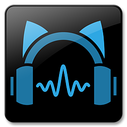

  

<h1 align="center">Blue Cat Oscilloscope Multi</h1>

  

---

## Overview

Blue Cat Oscilloscope Multi displays audio waveforms in real time across multiple channels simultaneously, essential for phase alignment, transient inspection, and waveform analysis.

Whether you're a newcomer just getting started or a seasoned pro looking for advanced tools, **Blue Cat Oscilloscope Multi** delivers the features you need in a clean, intuitive package.

---

## Key Features

| Feature | Description |
|---------|-------------|
| **Multi-Channel** | Monitor up to 8 channels simultaneously with color-coded traces |
| **Trigger** | Adjustable trigger level and slope for stable waveform display |
| **Zoom** | Time and amplitude zoom for precise waveform inspection |
| **Phase Mode** | X-Y phase correlation display for stereo field analysis |

---

## System Requirements

| Component | Minimum | Recommended |
|-----------|---------|-------------|
| **OS** | Windows 10 / macOS 11 | Windows 11 / macOS 13+ |
| **RAM** | 4 GB | 8 GB+ |
| **Storage** | 500 MB | 2 GB+ |
| **Internet** | Required for activation | Broadband recommended |

---

## Installation

Getting started with **Blue Cat Oscilloscope Multi** is quick and straightforward.

1. **Download** the installer for your operating system above
2. **Run** the installer and follow the on-screen instructions
3. **Launch** Blue Cat Oscilloscope Multi from your desktop or applications folder
4. **Configure** your preferences in the settings panel

---

## Community & Stats

---

## Support the Project

---

## License

This project is distributed under a free-to-use license. See the repository for full license details.

**Made with ❤️ for the Audio Effects community**

